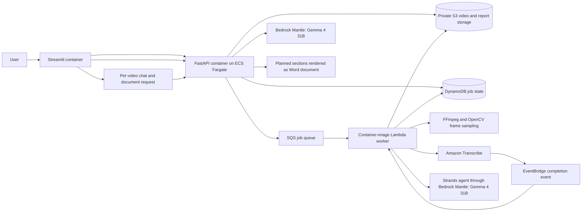

# ClassLens AI: Evidence-Based Lesson Quality Assessment

## Video chat agent and Word document output

ClassLens supports lecture analysis, grounded video chat, and a single autonomous document agent. All AI reasoning uses one model, Bedrock Mantle `google.gemma-4-31b`; deterministic Python scoring calculates percentages and weighted totals. Start with **Run locally with Docker Compose** below. The API contract, Bedrock configuration, chat memory, document response format, and multi-step planning improvement are described in [docs/autonomous_document_agent.md](docs/autonomous_document_agent.md).

For a concise engineering transfer guide with local setup, service responsibilities, validation status, API routes, and known boundaries, see [docs/HANDOFF.md](docs/HANDOFF.md).

## Implemented Docker and AWS flow

This repository now contains the requested asynchronous implementation:



FastAPI validates MP4/WebM uploads, stores each video privately in S3, writes a queued job to DynamoDB, and sends its ID to SQS. A Lambda container consumes one queue message at a time. It reads duration with FFmpeg, starts asynchronous Amazon Transcribe, and resumes the same job from an EventBridge completion event. A delayed SQS check recovers if the best-effort Transcribe event is missed. FFmpeg samples frames across the recording; OpenCV pHash removes near-duplicates. The Strands evaluator receives timestamped transcript segments and actual JPEG frame blocks, follows `prompts/classlens_evaluation_prompt.md`, and can call the registered `calculate_classlens_score` tool. Python validates evidence references and replaces all aggregate fields with its deterministic score. Job state stays in DynamoDB; uploads, transcripts, and reports are private S3 objects with lifecycle expiration.

The API stores a lecture TODO plan and task statuses in DynamoDB as the worker advances. Once a job is complete, `/jobs/{job_id}/chat` answers follow-up questions from the transcript, sampled-frame assessment observations, and recent conversation history. Conversation turns are saved with the job; the API keeps a bounded in-memory cache of the assessment context to avoid rereading its S3 result on every turn. `POST /agent` plans and executes a requested business document, optionally grounding it in a completed lecture job and its conversation, then returns a JSON execution manifest and the actual `.docx` file in one `multipart/mixed` response. For video-based documents, the file is also saved privately in S3 and can be downloaded again from the job. Video assessment, chat, and document planning/writing all use the same Bedrock Mantle Gemma model.

### Run locally with Docker Compose

The API, Streamlit UI, and polling worker run in containers and connect to the deployed AWS S3 bucket, SQS queue, and DynamoDB table. Amazon Transcribe reads the uploaded video from S3, and the evaluator calls Amazon Bedrock. The Docker services mount `~/.aws` read-only for AWS authentication.

Prerequisites: Linux with Docker Engine and the Docker Compose v2 plugin (`docker compose`), AWS SAM CLI, and AWS credentials allowed to use S3, Amazon Transcribe, and Bedrock Mantle Gemma. Docker mounts `~/.aws` into the API and worker containers.

1. From the repository root, build and deploy the AWS stack (see **Deploy the AWS stack**). Save the `VideoBucketName`, `JobsTableName`, and `JobsQueueUrl` outputs. The stack creates the private bucket, DynamoDB state table, SQS queue and DLQ, and Lambda worker.
2. Copy the sample environment file and edit the four required values:

   ```bash
   cp .env.example .env
   ```

   Set `AWS_PROFILE` to the profile in `~/.aws`, `LOCAL_UID` and `LOCAL_GID` to the values from `id -u` and `id -g`, `AWS_REGION` to the stack region, `CLASSLENS_UPLOADS_BUCKET` to `VideoBucketName`, `CLASSLENS_JOBS_TABLE` to `JobsTableName`, `CLASSLENS_QUEUE_URL` to `JobsQueueUrl`, `BEDROCK_MODEL_ID=google.gemma-4-31b`, and `BEDROCK_MANTLE_REGION=us-east-2`. S3 and Transcribe can remain in the stack region. Leave both endpoint URL variables blank to use AWS directly. Docker mounts the AWS config read-only and the `aws login` token cache writable so the SDK can refresh its short-lived token.

   Set `BEDROCK_MODEL_ID=google.gemma-4-31b` and `BEDROCK_MANTLE_REGION=us-east-2`. All reasoning features use this same Bedrock model.

3. Start the local server and its dependencies:

   ```bash
   docker compose up --build -d
   docker compose ps
   ```

4. Check the API, then open the Streamlit frontend:

   ```bash
   curl http://localhost:8000/health
   # Expected: {"status":"ok"}
   ```

   Visit <http://localhost:8501>, describe the lecture-analysis focus, upload an MP4 or WebM, and follow its TODO list until the report appears. You can then ask questions in the chat and request a study guide, report, or other Word document. The API is available at <http://localhost:8000>; interactive API docs are at <http://localhost:8000/docs>.

5. Follow service logs while diagnosing a local run, or stop the stack when finished:

   ```bash
   docker compose logs -f api worker frontend
   docker compose down
   ```

`docker compose down` stops the local containers. It does not delete cloud resources or S3 uploads; uploaded media and derived artifacts expire according to the bucket lifecycle. A profile, region, bucket, table, queue, or model mismatch—or missing AWS permissions—will prevent analysis.

### Run the end-to-end lifecycle test

The integration test exercises the real upload route, job creation, worker SQS event handler, processing state transitions, report persistence, and report retrieval. It replaces AWS and AI provider calls with in-memory test doubles, so it needs no credentials, Docker, or lesson video. From the repository root:

```bash
python -m venv .venv
source .venv/bin/activate
pip install -r requirements-test.txt
pytest -q
```

### Deploy the AWS stack

`infrastructure/template.yaml` provisions the private encrypted S3 bucket, DynamoDB job table with TTL, SQS queue and dead-letter queue, a container-image Lambda worker with reserved concurrency 1, and the Transcribe completion rule. The template takes an immutable ECR image URI so deployments use a pinned worker build. Build and push the image, then deploy from the repository root:

```bash
docker build -f worker/Dockerfile.lambda -t classlens-worker:deploy .
aws ecr get-login-password --region us-east-2 | docker login --username AWS --password-stdin <account-id>.dkr.ecr.us-east-2.amazonaws.com
ACCOUNT_ID=$(aws sts get-caller-identity --query Account --output text)
WORKER_REPOSITORY=classlens-worker
aws ecr create-repository --repository-name "$WORKER_REPOSITORY" --region us-east-2
docker tag classlens-worker:deploy "$ACCOUNT_ID.dkr.ecr.us-east-2.amazonaws.com/$WORKER_REPOSITORY:deploy"
docker push "$ACCOUNT_ID.dkr.ecr.us-east-2.amazonaws.com/$WORKER_REPOSITORY:deploy"
IMAGE_DIGEST=$(aws ecr describe-images --repository-name "$WORKER_REPOSITORY" --image-ids imageTag=deploy --region us-east-2 --query 'imageDetails[0].imageDigest' --output text)
aws cloudformation deploy --template-file infrastructure/template.yaml --stack-name classlens-ai --region us-east-2 --capabilities CAPABILITY_IAM --parameter-overrides "WorkerImageUri=$ACCOUNT_ID.dkr.ecr.us-east-2.amazonaws.com/$WORKER_REPOSITORY@$IMAGE_DIGEST" BedrockModelId=google.gemma-4-31b BedrockMantleRegion=us-east-2
```

Use the Bedrock Mantle model ID `google.gemma-4-31b` in `us-east-2`. Gemma 4 accepts text and images through the Mantle Responses API; each request is capped at 3.5 MB, so the evaluator uniformly reduces the frame set when needed. The deployment role needs permissions to create the SAM resources and ECR image. The Lambda role is scoped to this stack's S3 bucket, DynamoDB table, queue, and selected Mantle model using `bedrock-mantle:CreateInference` and short-term `bedrock-mantle:CallWithBearerToken`; a project-scoped `bedrock-mantle:ListModels` permission supports the worker catalog diagnostic event `{"source":"classlens.mantle","action":"list_models"}`. Amazon Transcribe requires `StartTranscriptionJob` on `*`; `GetTranscriptionJob` is scoped to this app's named jobs.

The API and Streamlit UI run together on ECS Fargate using `infrastructure/ecs-web.yaml`; the API calls Bedrock Mantle Gemma directly. Supply an ECS cluster, VPC, two public subnets, API/UI image URIs, and the S3/table/queue outputs from the SAM stack. The Fargate task receives public IP access for AWS service calls. The template exposes the ALB over HTTP because a domain-validated ACM certificate is not included. For a production deployment, attach a validated certificate and enable HTTPS, then add user authentication and job ownership checks before sharing sensitive lecture content.

Amplify Hosting cannot run a Streamlit server process. This implementation therefore hosts the requested Streamlit frontend on Fargate alongside FastAPI. Amplify becomes an option if the frontend is later rewritten as a static or supported SSR application.

### Job API and operational constraints

- `POST /jobs` accepts a multipart `file` and optional `request`; it returns a queued job ID (`202`). `GET /jobs/{job_id}` returns state, stage, progress, persisted TODO statuses, conversation history, and the completed assessment.
- `POST /jobs/{job_id}/chat` accepts `{"message":"..."}` after assessment completion and returns a grounded answer plus the persisted conversation.
- `POST /agent` accepts `{"request":"...", "job_id":"optional-completed-video-job"}` and returns a multipart execution manifest and `.docx` attachment. The manifest includes the agent-generated plan, step statuses, provider, and source job ID. A document generated from a video job is persisted in S3 and can be fetched with `GET /jobs/{job_id}/documents/{document_id}`.
- SQS is at-least-once delivery; the worker skips already-completed jobs and Transcribe start is idempotent by job ID. Worker concurrency is one; failed queue messages are retried and then moved to the dead-letter queue.
- Reports and Transcribe output are stored in S3 rather than DynamoDB so a full transcript does not hit DynamoDB's per-item size limit. Report, transcript, and upload prefixes expire according to `RetentionDays`.
- The evaluator receives transcript text and frames, not raw audio. The Audio and Verbal Communication score is therefore always `null`; the report explains that evidence limitation instead of guessing audio quality from words.
- FFmpeg samples at a configurable interval, caps frame count, and pHash deduplication reduces repeated slide frames. This is a heuristic: a presenter covering a large part of a slide can still cause a near-duplicate to pass through.
- Lambda processing after transcription must fit the Lambda 15-minute runtime. Very long or high-resolution recordings may exceed this limit; deploy a long-running ECS worker consumer for those workloads and retain SQS as the queue.
- The starter API has no user authentication or per-user authorization. The current load balancer endpoint uses HTTP. Do not submit sensitive lecture recordings or expose the app broadly until HTTPS, Cognito/SSO identity checks, and job ownership checks are configured. Private S3 objects, least-privilege IAM, and retention do not replace access control.

The scoring rubric and evaluator contract are in `prompts/classlens_evaluation_prompt.md`.


## Repository layout

```text
api/main.py                 FastAPI routes
app.py                      Streamlit frontend
src/classlens/              Shared pipeline, model, scoring, storage, chat, and DOCX logic
worker/                     Lambda and local queue consumers
infrastructure/             AWS SAM data/worker and ECS web templates
prompts/                    Evaluation prompt
tests/                      API and worker lifecycle tests
docs/                       Handoff, agent design, architecture image, and recording script
Dockerfile.api, Dockerfile.ui, worker/Dockerfile*
requirements*.txt           Runtime-specific dependency sets
```

The detailed deployment status and operational limits are in [docs/HANDOFF.md](docs/HANDOFF.md). The document agent's prompt, response format, and planning improvement are described in [docs/autonomous_document_agent.md](docs/autonomous_document_agent.md).
